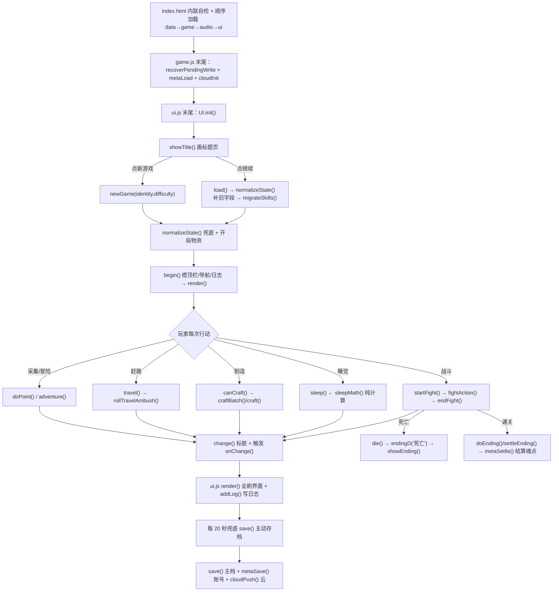

# 《孤屿遗章》整体代码结构与简化建议

> **本文是 2026-09-22 的快照，运行时事实以 [维护现状.md](../维护现状.md) 为准。**
>
> 本轮为**只读分析**：不修改游戏源码、测试、版本、公告或发布包。
> 面向「代码小白」：先用生活化比喻讲清楚，再给准确的文件/函数名。
> 证据以 2026-09-22 工作区源码为准（`孤屿遗章-游戏 - 发布/`）。

---

## 一、一个生活化的比喻

把整个游戏想象成一台**老式打字机改的自动售货机**：

- **`index.html`（机身外壳 + 开机自检）**：负责立好骨架、按顺序把零件装进去，还装了一块「万一某个零件没装上，也能显示求救按钮」的自检小屏幕。
- **`js/data.js`（商品价目表 + 场地说明书）**：一大本「字典」，只写「有哪些东西、多少钱、什么配方、哪个场景怎么走、怪物是谁」。它自己不动手，只供别人查。
- **`js/game.js`（机器内部的齿轮心脏）**：所有「算账」都在这——时间走多快、血掉多少、打不打得过、能不能造、存档怎么写。它不画画面，只改一本「当前状态账本」。
- **`js/ui.js`（玻璃橱窗 + 按钮 + 显示器）**：负责「把齿轮算出来的结果摆给人看、把人按的按钮翻译成指令」。玩家摸到的一切都是它画的。
- **`js/audio.js`（自带的小音箱）**：不靠外部 mp3，用浏览器合成风声、鸟叫、打击声和背景音乐。
- **`css/style.css` 与 `css/panels.css`（外壳配色 + 橱窗排版）**：决定东西长什么样、按钮放哪、弹窗多宽。

一句话分工：**data 说「有什么」，game 算「怎么变」，ui 画「长啥样」，audio 播「什么声」，css 管「摆哪」**。

---

## 二、目录树与脚本加载顺序

### 2.1 运行目录（唯一源码来源）

游戏只从 `孤屿遗章-游戏 - 发布/` 读取。根目录其余部分（`回归测试/`、`开发工具/`、`文档/`、`归档/`、各设计文档）都不进游戏包，只有 `孤屿遗章-游戏 - 发布/` 会被打包发布。

### 2.2 `index.html` 脚本加载顺序（执行顺序是关键）

```
1. html 头部内联脚本：window.BUILD_VER 版本号 + 启动自检(失败显示诊断)
2. <link> css/style.css?v=版本号     ← 基础主题/标题/场景/通用控件
3. <link> css/panels.css?v=版本号    ← 制造/背包/装备三面板共享布局
4. <script src="js/data.js">        ← 先读数据（字典）
5. <script src="js/game.js">        ← 再装心脏（会读 data 里的表）
6. <script src="js/audio.js">       ← 接着装音箱
7. <script src="js/ui.js">          ← 最后装玻璃橱窗（依赖前面全部）
```

加载顺序为什么不能乱：`ui.js` 一开始就调用 `Game.bind(...)`、末尾调 `UI.init()`；`game.js` 在定义完 `Game` 后立刻执行 `recoverPendingWrite()`、`metaLoad()`、`cloudInit()`（第 4430~4432 行）。所以 **data → game → audio → ui** 是当前运行方式的硬依赖。理论上可以用构建工具合并文件，只要保持执行顺序；但本项目刻意保持无构建依赖，现在没有必要为此增加发布复杂度。

### 2.3 关键资源分类（按目录作用）

| 位置 | 内容 | 谁在读 |
|---|---|---|
| `js/*.js` | 四个核心脚本 | index.html 顺序加载 |
| `css/*.css` | 两个样式文件 | index.html |
| `assets/img/items/` | 物品黑白图标（自绘/生成 png） | ui.js 的 `itemIcon()` |
| `assets/img/items-accent/` | 「深海琥珀」彩色图标 | ui.js `itemIcon()`（只有 4 件） |
| `assets/img/anim/` | 采集动作图标（pick、berry_pick、water_ladle 等） | ui.js 动画层 |
| `assets/img/endings/` | 五个结局大图 | ui.js `showEnding()` |
| `assets/img/` 其余 | 场景图、地图、立绘、开场分镜 | renderScene/renderMap/showTitle/showComicIntro |

---

## 三、四个核心文件逐份说明

### 3.1 `js/data.js`（1481 行）—— 纯数据字典

**职责**：所有游戏内容的唯一数据来源，几乎全是被 `const` 声明的对象/数组字面量。

主要数据表（都定义在此文件）：

| 表名 | 行号 | 内容 |
|---|---|---|
| `ITEMS` | 9 | 全部物品（原料/食物/武器/图纸…），含 `cat`、`glyph`、价格、耐久 |
| `IDENTITIES` | 222 | 五种身份（渔夫/灵灰等） |
| `DIFFICULTIES` | 231 | 四档难度参数 |
| `SCENES` | 243 | 所有场景（营地/树林/河畔…）与解锁条件 |
| `RECIPES` | 491 | 全部制造配方（材料→产出→工坊归属） |
| `CROPS` / `BUILDING_CHAINS` / `FURNITURE` | 629/636/683 | 农田、建筑升级链、家具 |
| `ATLANTIS_*` | 726~762 | 第二章海底文明 |
| `ENEMIES` | 767 | 怪物数据 |
| `LAOCHAO` / `TOWN` / `BLACKMARKET` | 805/833/851 | 三个交易对象 |
| `STORY_EVENTS` / `RANDOM_EVENTS` | 857/871 | 剧情与随机事件 |
| `WEATHER` / `SEASONS` | 928/936 | 天气、季节 |
| `PATCH_NOTES` | 1082 | 历史公告（旧公告数据，见第六节） |
| `ENDINGS` | 1288 | A/B/C/D/S/S2 六个结局 |
| `SKILL_TREES` / `META_NODES` / `RELICS` / `DURA` | 1333/1408/1425/1434 | 技能树、历代遗章、神物、耐久表 |

**特点**：这个文件「既大但又不危险」——它 90% 是数据声明，没有复杂逻辑，行数多是因为内容本来就多（一百多物品、一百多配方、六个结局、大量文案）。**不建议为了「变短」去拆它**（见第六节 C 级）。

### 3.2 `js/game.js`（4760 行）—— 游戏引擎（心脏）

**职责**：玩法与存档的唯一实现。它用一个 IIFE（立即执行函数）包起来，只通过末尾 `return { ... }`（4710~4759 行）暴露接口，其余全是闭包内部的私有函数。

关键内部结构（按游戏运行流程）：

**① 状态与存档基础设施**
- `S`（全局状态对象，单局进度）：`inv` 背包、`stats` 五维、`equipment` 装备、`buildings/furniture` 建筑家具、`flags` 剧情标记、`day/minute` 时间……
- `M`（账号级数据，跨局）：魂点、成就、图鉴、备份槽、皮肤、邮箱。
- 本地存储键：`guyuyizhang_save`（主档）、`guyuyizhang_save_bak`（备份）、`guyuyizhang_meta`（账号）、`guyuyizhang_write_journal`（写入恢复日志）、云存档 `cloud` 对象。
- `persistPair()`（28 行）：主档+账号一起改时，先写恢复日志、任一步失败回滚——**存档安全的底线，不能简化**。
- `save()`（880）/ `load()`（922）/ `newGame()`（964）/ `normalizeState()`（4615）。

**② 时间推进链路**
- `addMin(m)`（449）→ 每小时掉饥渴/冷热/中毒 → 跨天调 `newDay()`（656）→ 结算农田/晾晒/事件。
- `HOUR_EFFECTS`（347）是每小时的身体影响。
- `isNight()` / `isDusk()`（643/644）：昼夜判定（已统一为全局函数，旧版 22/6 点魔法值已删）。

**③ 每次「行动」的入口**
- `doPoint(p)`（1391）采集点位、`adventure(p)`（1640）冒险、`travel()`（1212）赶路、`craft()`（3231）制造、`rest()/sleep()`（3719/2886）休息睡觉、`fightAction()`（2449）战斗。

**④ 战斗链路**
- `startFight()`（2358）→ `fightAction()`（2449，约 244 行核心）→ `endFight()`（2693）→ 夜袭 `nightRaid()`（2805）。

**⑤ 制造链路**
- `canCraft()`（3127）→ `craftBatch()`（3296）/ `craft()`（3231）；晾晒 `dryCollect()`（3179）。

**⑥ 对外接口与 UI 的关系**
- `bind(o)`（4713）：UI 注册的回调 `onLog/onChange/onFight/onEnding/onOverlay/onSaveFail/onSaveConflict`——**这是 game 通知 ui 的唯一通道**。
- `change()`（约 78 行附近）：任何状态变化后调它，它会触发 `onChange()`（→ UI 的 `render()`）并写脏标记。
- 导出对象里密密麻麻的 `function` 引用（4710~4759）全是 UI 要调用的能力，例如 `Game.travel`、`Game.craft`、`Game.sleepForecast`、`Game.playerAtk`。

### 3.3 `js/ui.js`（3917 行）—— 界面层（玻璃橱窗）

**职责**：渲染 + 事件绑定。玩家可见的一切都出自这里。

关键函数（按流程）：

| 函数 | 行号 | 作用 |
|---|---|---|
| `Game.bind(...)` | 37 | 注册日志/刷新/战斗/结局等回调 |
| `render()` | 271 | 总刷新入口（改状态后 UI 全刷） |
| `renderScene/renderMap/renderHotspots` | 1024/631/1239 | 场景/地图/热点 |
| `showModal(kind,cfg)` | 2732 | 弹窗总入口，一串 `else if` 按 kind 分发 |
| `bindModal(kind,cfg)` | 2840 | 弹窗按钮事件绑定，约 440 行 `data-*` 分发 |
| `renderCombat(kind,C)` | 2343 | 战斗界面（配合 game 的 fightAction） |
| `showTitle/begin` | 3507/3741 | 标题页 / 进游戏 |
| `showEnding` | 3447 | 结局页 |
| `init()` | 3885 | 启动：读皮肤/日志设置、崩溃检测、画标题 |

**与 game 的耦合方式**：业务状态的修改基本都通过 `Game.xxx()`，UI 通过 `Game.bind` 收通知；界面读状态时使用 `Game.S()`。静态检查没有发现 `ui.js` 直接给 `S()` 字段赋值，但它会读取装备、教程、场景等字段来决定显示和按钮行为。这种边界总体清楚，也带来了 `bindModal` 里大量「点哪个按钮 → 调哪个 Game 函数 → 弹回哪个面板」的样板代码。

**UI 内部还有一块「纯展示」重复点（已被上一轮修掉一半）**：睡眠公式曾被 `ui.js` 的 `sleepRec()/napRec()` 抄了一遍，现已删掉、改调 `Game.sleepForecast()`（见维护现状 2026-09-22）。

### 3.4 `js/audio.js`（444 行）—— 程序化音频引擎

**职责**：纯 Web Audio 合成，**没有任何外部音频文件**。环境音分层 + 生成式氛围配乐 + 音效。

- `init()`（23）：建 AudioContext、主音量、音乐/音效双总线、混响。
- `setScene(setSceneId, deep)`（97）：切换场景环境层。
- `startMusic()`（337）/ `motif()`（216）/ `play(sfx)`（384）：配乐与音效。
- 导出 `return { init, toggle, setScene, play, ... }`（443）。

**特点**：这个文件相对独立、规模适中、无外部资源依赖，是四个文件里最「干净」的一个，基本不需要动。

---

## 四、核心调用链（从开机到每一步）



**读档后为什么「必须立刻写回」**：`normalizeAfterLoad()`（4703）会在补字段、跑迁移后立刻 `save()`，否则标题页「继续上次游戏」还指向上一次、且 `save()` 会误判「别的标签页更新了进度」而拒绝写入。

---

## 五、可维护性盘点（带代码证据）

> 原则：**只因为「文件大」就拆 = 错误**。是否拆分看「职责单一、耦合、重复」三件事。

### 5.1 文件规模与明显超长函数

| 文件 | 行数 | 备注 |
|---|---|---|
| `js/game.js` | **4760** | 最大，引擎全在里面 |
| `js/ui.js` | **3917** | 界面全在里面 |
| `js/data.js` | 1481 | 几乎纯数据，行多但无害 |
| `js/audio.js` | 444 | 独立、干净 |

超长函数（候选关注点，非必须拆）：

| 函数 | 行号 | 约行数 | 多职责点 |
|---|---|---|---|
| `fightAction()` | game.js 2449~2693 | ~244 | 攻/防/远程/横扫/投掷/道具/逃跑，一个函数里分支极多 |
| `doPoint()` | game.js 1391~1640 | ~249 | 采集点位判定 + 动画 + 奖励 + 遇袭，多条路径 |
| `bindModal()` | ui.js 2840~3281 | ~440 | 80+ 条 `data-*` 点按分发（看似重复，实为按弹窗分发） |
| `showModal()` | ui.js 2732~2838 | ~106 | 一串 `else if` 弹窗渲染分发 |

### 5.2 重复公式（已解决 vs 仍存在）

- **已解决（上一轮 accessor/昼夜/命名加成重构）**：
  - 饰品取数 6 处 → 统一 `accessoryStat(key)`（1827）。
  - 命名加成 3 处 → 统一 `weaponBonus(id)` / `itemKeyOf(it)`（1831/1836）。
  - 夜间判定内联 22/6 点 → 统一 `isNight()`（643）。
  - 睡眠公式 ui.js 自抄一份 → 删掉，改调 `Game.sleepForecast()`。
  - **结论：主要重复点已经消除。** 再往下的「重复」更多是**结构相似但语义不同**，不是同类 bug 温床。

- **仍存在的「结构相似」**（不建议贸然合并）：
  - `bindModal` 里大量 `m.querySelectorAll('[data-xxx]').forEach(...)` 模板，每条绑一个不同 Game 函数。可以用一张「选择器→回调→回弹面板」的表驱动来压缩，但**每条的副作用各不相同**（有的带动画、有的要 `!S().death` 判断、有的回弹不同面板），硬压成表反而更难读、更容易改错（属 B 级）。

### 5.3 重复 UI 分发

- `showModal` 的 `else if` 链 + `PANEL_KINDS` 名单（ui.js 3839）+ `TIME_FREEZE_PANELS` 名单（2715）——三个地方各自列举「哪些是面板/哪些冻结时间」。这三份名单**有重叠但目的不同**，属于可整理但需专项回归的候选（B 级）。

### 5.4 死代码候选（逐项只能标「候选，需验证」）

| 候选 | 位置 | 证据 | 判定 |
|---|---|---|---|
| `.resource-tip` 样式 | style.css:378、panels.css:199 | 维护现状记录「制造页 resource-tip 整块删除」，但 grep 证实该 class **仍在邮箱公告页（ui.js:2497 `class="hint resource-tip"`）使用** | **不是死代码，不能删**（曾有候选假设，已被逐项核实推翻） |
| `ANIM_SVG = {}` 空表 | ui.js:363 | 维护现状「清空为 {} 保留为将来兜底的空表」 | **不建议删**（有意保留的兜底） |
| 旧公告数据 `PATCH_NOTES` | data.js:1082 | 旧版本公告，仍被邮箱/公告渲染引用 | **不能当作死代码删**（见第六节） |
| `itemIcon` 里 `onerror` 兜底 | ui.js:20 | 找不到彩色图回退黑白 | 运行时兜底，非死代码 |

### 5.5 兼容兜底（不是死代码，是红线）

- `normalizeState()`（game.js 4615~4702）：读进任何老存档/备份槽/救援档后补缺失字段。**每一条 `if (!S.xxx)` 都是老档兼容，删了会让旧档崩或读档失败。**
- `migrateSkills()`（756）：老版技能点 → 新技能树的幂等迁移。
- `DIFFICULTIES[...] || 1`、`enSpd || 10` 这类防御性兜底：维护现状明确标注「防御性兜底不能省」。
- 存档安全：`persistPair` + 恢复日志 + 备份，全部**不能简化**。

### 5.6 调试/发布工具与正式回归的配合

- `回归测试/run.js`：统一入口，`core`（多组）与 `--browser`（12 组场景/触控）两类。失败返回非零。
- `回归测试/checks.js`：行为断言（当前 963 项，含 accessor/昼夜/命名加成/睡眠公式的行为级断言）。
- `开发工具/检查/_dead_code.js`、`_audit_sources.js`：**只读诊断，不是安全删除清单**（README_目录说明 明确写了）。
- `开发工具/检查/_sweep_dev.js`：开发者难度全场景扫 undefined/NaN。
- 发布流程：`_bump_version → run.js --browser → _pack.py → _verify_zip.py`，版本号只在 `index.html` 的 `BUILD_VER` 唯一定义、六处缓存参数同步。

---

## 六、特别评估（逐个回答）

### 6.1 `game.js` 要不要拆模块？怎么拆才不增加部署风险？

**结论：暂不整体拆，但可以在「无构建依赖」前提下做「提取纯函数」式轻拆。**

- **为什么不整体拆**：现在是**单文件 IIFE + 全局 `Game`**，没有模块系统。若拆成 `game-core.js / game-combat.js / game-save.js` 多个文件：
  - 要引入 `<script>` 多段加载或手写模块注册，**顺序一乱就是全局变量未定义**；
  - 大量私有函数互相引用（如 `fightAction` 用 `playerAtk/playerDef/combatSpeed/sharpAm`…全是闭包内函数），拆文件就要全部转成参数传递或挂到共享对象，改动面大、回归成本高；
  - **部署风险上升**（多文件、多 cache-busting 参数、浏览器逐个加载）。
- **可不增加风险的轻拆法**：把**无状态、不碰 `S`、不读 DOM** 的纯计算/查表函数抽成同文件内或独立 `const` 区块，或拆成 `data.js` 同级的「纯工具文件」但保持全局 const 导出——但这些收益有限，因为当前重复点已被上一轮重构清掉了大半。
- **更务实的建议**：如果后续 `game.js` 还要长，**优先按「职责」把函数签名整理清、给 `fightAction` 拆子步骤**（attack/defend/item/flee 各自成子函数），这比拆文件更有价值、风险更小。

### 6.2 `bindModal`、`fightAction`、存档迁移、旧公告、调试/发布工具——哪些能整理、哪些不能删？

| 项 | 能否整理 | 能否删 | 说明 |
|---|---|---|---|
| `bindModal`（440 行分发） | 可按营地/装备/交易/存档等领域拆成数个绑定函数（B 级） | 不能删 | 每条的副作用不同，属结构性重复而非死代码；不宜强行塞进一张大表 |
| `fightAction`（244 行多职责） | 可**拆分内部子步骤**（B 级） | 不能删 | 战斗数值主战场，拆错一处就是平衡 bug |
| 存档迁移/兼容代码（`normalizeState`/`migrateSkills`/`persistPair`） | 不能整理（保持原样才安全） | **绝对不能删** | 旧档/备份/救援恢复的底线 |
| 旧公告数据 `PATCH_NOTES` | 可考虑**归档旧条目**（C 级，暂不动） | 不能当死代码删 | 邮箱公告页会按版本渲染，删了会断 |
| 调试工具（`devEnabled/unlockDev`） | 保持 | 不能删 | 开发者模式，有密码门禁 |
| 专用探针（`开发工具/检查/_verify_*`、`_debug_*`） | 归类已做 | 不删 | 属开发工具，不进游戏包 |

### 6.3 accessor/昼夜/命名加成重构是否已解决主要重复点？

**是，主要高风险的重复点已解决。** 上轮把「同一条公式各写一遍」造成的、**一旦改一处漏一处就会数值/图标/死亡判定不一致**的几类重复都收敛到了单一函数，并且配了行为级断言（963 项 audit）防回退。剩下的「重复」多是 UI 分发样板和 showModal/名单列举，属于**可读性层面的冗长**，不是会产生隐蔽 bug 的「公式重复」。

---

## 七、从哪里开始读（30 分钟顺序）

1. **0~5 分钟**：打开 `index.html`，只看头部脚本顺序和末尾四个 `<script>`，理解「data→game→audio→ui」。
2. **5~12 分钟**：`js/data.js` 顶部 `ITEMS`（9 行起）看两三个物品字段，再跳到 `SCENES`（243）看一个「营地」场景对象——明白「字典」长什么样即可，不用全读。
3. **12~20 分钟**：`js/game.js` 末尾 `return { ... }`（4710~4759），这是**全部对外接口的目录**；再回头读 `change()`（78 附近）和 `addMin()`（449），理解「状态变了 → 通知 UI」。
4. **20~26 分钟**：`js/ui.js` 开头 `Game.bind(...)`（37~60）看 UI 怎么收通知；再读 `showModal()`（2732）开头几个 `else if`，理解弹窗分发。
5. **26~30 分钟**：`js/audio.js` 的 `init()`（23）和 `play(sfx)`（384）随便扫一眼，知道它是「合成声音、不依赖文件」即可。

读完这五步，你就能自己顺着「点一个按钮 → Game.xxx → change → render」这条线追代码了。

---

## 八、建议清单（分级）

| 级别 | 建议 | 收益 | 风险 | 预计范围 | 是否建议现在做 |
|---|---|---|---|---|---|
| ~~删除 `.resource-tip` CSS~~ | ~~初判死代码~~ | — | — | — | **已核实不能删**：邮箱公告页（ui.js:2497）仍用此 class，CSS 非死代码 |
| **A** | 不改运行时代码，维护本文件的架构索引与阅读入口 | 新接手者不用反复考古 | 无 | 文档 | **已经完成** |
| **B** | `fightAction` 拆子步骤（attack/heavy/ranged/defend/item/flee 各成子函数） | 可读性、后续改战斗更安全 | 中，需战斗专项回归 + 固定种子战斗模拟 | game.js 2449~2693 | 以后局部做 |
| **B** | `doPoint` 按「校验→动画→奖励→遇袭」拆内部步骤 | 采集规则更容易定位和测试 | 中，需采集/遇袭专项回归 | game.js 1391~1640 | 以后局部做 |
| **B** | `bindModal` 按营地、装备、交易、存档等领域拆成数个绑定函数 | 降低单函数阅读负担，比大而全的表驱动更直观 | 中，每条副作用不同需逐条核对 | ui.js 2840~3281 | 以后局部做 |
| **B** | 统一「面板名单」：`PANEL_KINDS` / `TIME_FREEZE_PANELS` / showModal 分支三处合并 | 少一处遗忘 | 中（漏一个面板会冻结时间错或无法点外关闭） | ui.js 3 处 | 以后局部做 |
| **C** | `game.js` 拆成多个文件/模块 | 想「分文件好维护」 | **高**：多文件加载顺序、跨文件闭包引用重构、部署 cache 参数全员同步，且当前重复点已不大 | 整个 game.js | **现在不建议**（见 6.1） |
| **C** | 归档/清理旧公告 `PATCH_NOTES` 旧条目 | 数据瘦身 | 中：公告按版本渲染，删错会断历史公告 | data.js 1082~1288 | 现在不建议（作者尚未要求） |
| **C** | 拆分 `data.js` 成多份小表 | 行数变短 | 低但不值得：纯数据、无逻辑、改动即引入引用遗漏 | data.js | 不建议（「文件大」不等于「该拆」） |

---

## 九、明确不建议删除 / 重构的部分（红线）

1. **存档相关一切**：`persistPair`、恢复日志 `WRITE_JOURNAL`、`restoreWrittenKeys`、`save/load/newGame/normalizeState/normalizeAfterLoad/migrateSkills`、备份槽/救援恢复/存档码。这些是「旧档兼容 + 防数据丢失」的底线，**任何 `if (!S.xxx)` 补字段都不能删**。
2. **防御性兜底**：`DIFFICULTIES[...]||1`、`enSpd||10`、`chainTier()`（建筑等级越界夹取，修过真 bug）等。
3. **战斗主战场 `fightAction`**：可以拆子步骤，但**不能改任何数值/判定行为**。
4. **`index.html` 的四段脚本执行顺序 + 启动自检 + cache-busting 版本号**：不能为了「精简」随意调整；若未来引入打包，也必须保持相同执行顺序。
5. **开发者模式与调试入口**（`devEnabled/unlockDev`、各 `_verify_*` 探针、`_dead_code`/`_audit_sources` 诊断脚本）：诊断脚本的注释已明确「不据此删内容」。
6. **旧公告数据、神物/皮肤/邮箱档位等既有存档案字段语义**：不删改。

---

## 十、本轮结论速览

- 项目结构清晰：**data=字典，game=心脏，ui=橱窗，audio=音箱，css=外观**，四段脚本的执行先后是当前架构的硬约束。
- 上一轮（accessor/昼夜/命名加成/睡眠公式）重构**已经解决了主要的高风险重复公式**，当前没有再出现「同类公式各写一份」的 bug 温床。
- 最大的两个「长」点（`game.js` 4760 行、`ui.js` 3917 行）是**职责集中 + 内容量大**，不是应该立刻拆的理由；`fightAction`（244 行）和 `bindModal`（440 行）是可读性冗长，属 B 级「以后局部整理」。
- `game.js` 已有完整的功能分区注释，`bindModal` 的关闭/返回绑定也已经集中在两行；继续抽取只会增加跳转。当前没有值得立即删除或重构的 A 级运行时代码，最安全的导航改进就是维护本报告（已完成）。
- 关于 `.resource-tip` 的 CSS：本报告初稿一度把它列为「死代码候选」，但**逐项 grep 核实后推翻**——该 class 仍在邮箱公告页（ui.js:2497）使用，不能删。这正是「删除建议必须逐项核实、证据不足只能标候选」的实例。
- 红线明确：**存档兼容、防御兜底、战斗数值、脚本加载顺序、调试工具**均不可删改。
